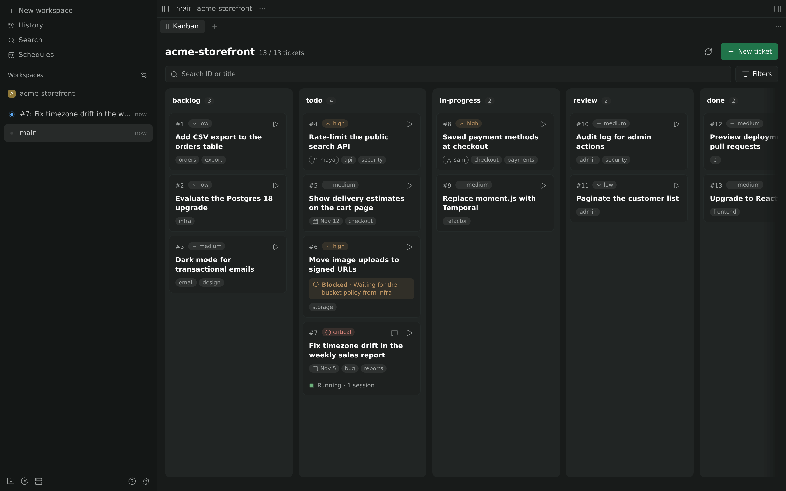
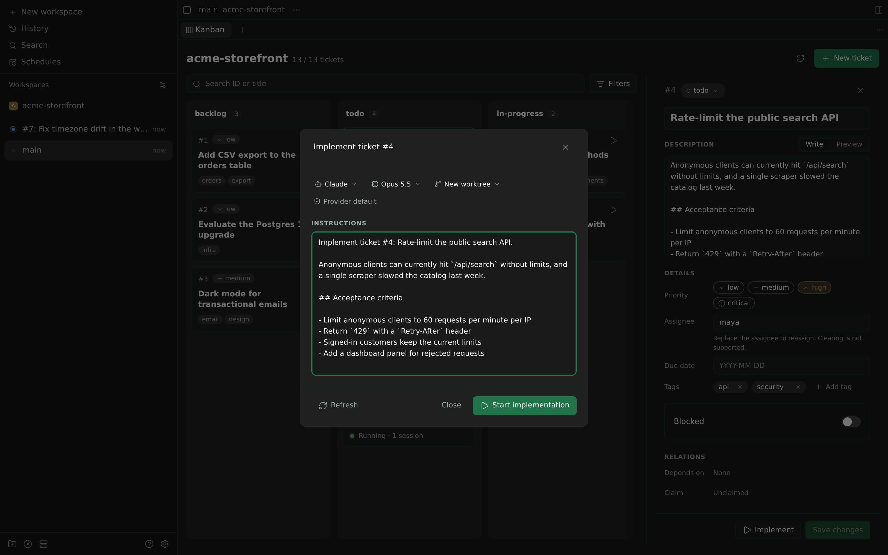
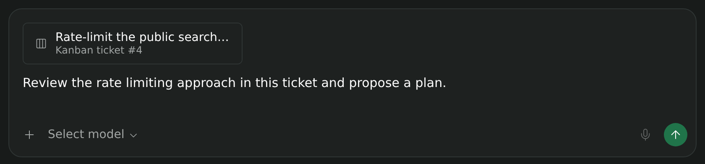

# Kanban for Paseo

A [Paseo](https://paseo.sh) plugin that shows a [kanban-md](https://github.com/antopolskiy/kanban-md) board as a workspace panel. Edit tickets, launch an agent on one, or attach one to any prompt. All writes go through the `kanban-md` CLI, so its claims and WIP limits still apply.



| Implement a ticket | Attach a ticket to a prompt |
| --- | --- |
|  |  |

## Requirements

- Paseo `^0.13.2 || ^0.14.0 || ^0.15.0`, with plugins enabled on the host.
- kanban-md 0.39.x on the daemon's `PATH`. The plugin runs `kanban-md` by name, so it must be installed on the machine running the daemon.
- Git, for launching into a new worktree.

## Install

```sh
paseo plugin install npm:@activechoon/kanban-md-paseo
```

Or from a checkout on the daemon machine. Paseo compiles the TypeScript on load, so there's no build step:

```sh
git clone https://github.com/ActiveChooN/kanban-md-paseo.git
cd kanban-md-paseo
npm ci --ignore-scripts
paseo plugin install "$PWD"
```

The plugin ID is `kanban-md`. Use `paseo plugin logs kanban-md` when something looks wrong.

## Usage

Open **Kanban** from the workspace panel picker or the Command Center.

Every workspace in a project, including sibling worktrees, shares one board at `<projectRootPath>/kanban`. If there's no board, the panel offers to create one. A broken or incomplete board shows an error and is never overwritten.

**Implement** starts an agent on a saved ticket. You pick a provider, model and workspace and can edit the instructions. The agent keeps the provider's default permissions and is told to claim the ticket itself through the CLI. The card then shows the agent's activity (Running, Needs input, Error, Idle). Idle only means the turn ended. The plugin never marks tickets done, merges or pushes.

**Attach Kanban ticket**, in the composer's attachment menu, adds a Markdown snapshot of a ticket to your prompt. Paseo doesn't tell attachment search which workspace you're in, so the plugin searches every project's board on the host. Type an ID (`#12`), title words or part of a project name.

The panel never overwrites your edits. If the ticket changed on disk, saving fails with a conflict and you choose whether to reload. If a write or launch times out, the panel blocks further writes until you refresh, and it never retries on its own. For a launch, use **Inspect launch** to find the agent it created.

## Limits

- kanban-md 0.39 can't clear an assignee, so the panel can only replace one.
- The plugin serializes its own writes per board, but edits from the CLI or an editor can still race them.
- Open panels poll every five seconds, including hidden tabs. Paseo doesn't report tab visibility to plugins.
- There's no drag-and-drop, archive or delete, or board config editing.
- Tested in the web app on Linux only.

## Development

Needs Node 24 and kanban-md 0.39.x on `PATH`.

```sh
npm ci --ignore-scripts
npm run typecheck
npm test            # unit, renderer and CLI tests against temporary boards
npm run test:host   # packs the plugin and runs it on a throwaway daemon with the mock provider
```

`test:host` never touches your own daemon. Add `-- --ui` to also drive the web app in Chromium. Set `KANBAN_TEST_CHROMIUM` to the browser, and optionally `KANBAN_TEST_WEB_DIST` to a web build.

[docs/architecture.md](docs/architecture.md) covers the design.

## License

[MIT](LICENSE)
